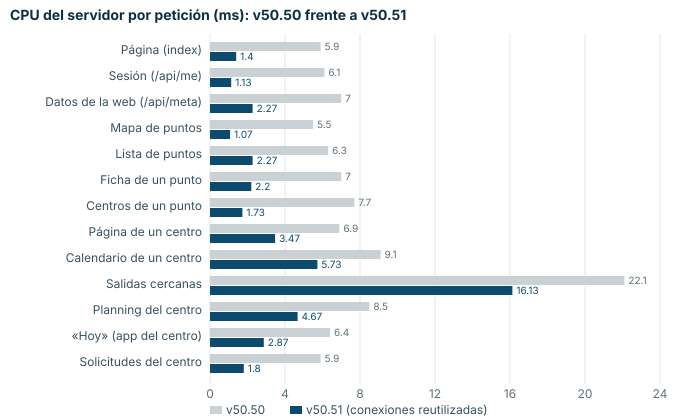
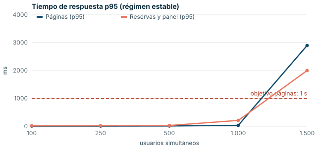
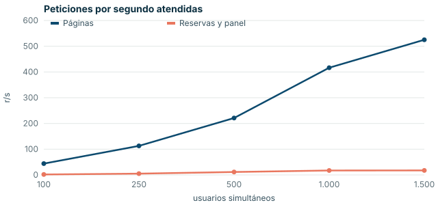
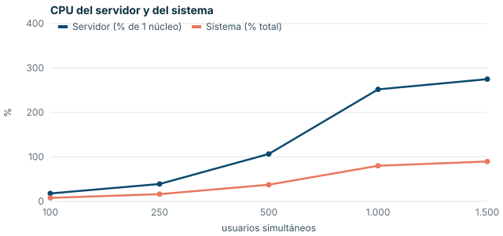

# WORLDIVES DISCOVERY v50.51 · Auditoría de carga

Fecha: 13/10/2026. Banco de pruebas en `tests/carga/` (Locust), prueba de integridad en
`tests/test_v50_51_concurrencia.py` y este informe.

## Resumen

| Pregunta | Respuesta |
|---|---|
| ¿Páginas en menos de 1 s y reservas en menos de 2 s? | **Sí, con mucho margen hasta 1.000 usuarios a la vez en un equipo de solo 4 núcleos** (páginas p95 33 ms, reservas p95 210 ms). Con los arreglos, una página cuesta de 1 a 3,5 ms de CPU |
| ¿Reservas duplicadas o plazas vendidas de más? | **Había 3 errores reales con peticiones simultáneas: corregidos.** Ahora 0 duplicados y 0 plazas de más (14 pruebas de concurrencia, con 1 y con 4 procesos) |
| ¿Bloqueos de la base, errores 500? | 0 hasta la rotura, con los arreglos |
| ¿Aguanta 10.000 usuarios a la vez? | **Con el VPS adecuado, sí** (cálculo abajo, con lo medido). La medida directa de 10.000 usuarios necesita generar la carga desde otras máquinas: desde un solo equipo de 4 núcleos no se pueden simular (serían unas 4.300 peticiones por segundo). Queda preparada y explicada en el apartado 6 |
| ¿Hace falta cambiar de servidor o de base de datos? | **De servidor, sí** para 10.000 usuarios intensos: un VPS de 32 vCPU y 32 GB (8 vCPU si el uso es normal). **De base de datos, no**: SQLite basta. PostgreSQL solo hace falta para repartir la web en varios servidores (más de unos 25.000 usuarios a la vez) |

## 1. Qué se ha medido y cómo

- **Uso realista**, mezclado: 70 % visitantes (portada, buscador, lista y ficha de puntos, centros, calendarios de
  salidas), 20 % buceadores (inicio de sesión con la contraseña real, presupuesto, reserva y pago en modo de prueba,
  «Mis reservas») y 10 % centros trabajando en su panel (planning, solicitudes que aceptan o rechazan, «Hoy»,
  manifiesto, check-in y cobro en el centro).
- Cada usuario simulado espera **de 3 a 10 segundos** entre una pantalla y otra (un uso intenso: una persona real
  suele tardar más) y tiene su propia IP, como detrás del proxy.
- **Pagos en modo de prueba**: un simulador local de Stripe; nunca se llama al Stripe real.
- Base de carga: la demo + 1.000 buceadores con contraseña real (PBKDF2 de 600.000 iteraciones, como en
  producción) + 40 centros verificados con 4.229 salidas futuras de 40 plazas.
- Se mide la media, p50, p95 y p99 de cada grupo (páginas, reservas y panel, inicio de sesión), los errores, la CPU y
  la memoria del servidor, el tamaño de la base y del WAL, los bloqueos de SQLite y los errores 500 del registro, y el
  punto de rotura: el primer escalón con páginas p95 > 1 s, reservas p95 > 2 s o más de un 1 % de errores.

## 2. Arreglos hechos

| Problema | Arreglo | Efecto |
|---|---|---|
| **Doble envío de una reserva** (doble clic o reintento): creaba dos reservas y, con «pago al reservar», tomaba el doble de plazas y abría dos pagos | La reserva se comprueba y se crea en una transacción inmediata; si es la misma persona, salida y número de plazas en los últimos 2 minutos, se devuelve la que ya existe | 0 duplicados |
| **Doble «Aceptar»** de una solicitud: descontaba las plazas dos veces | Leer y cambiar el estado en una transacción inmediata (también el cobro en el mostrador) | Plazas exactas |
| **Pago confirmado a la vez** (aviso de Stripe, vuelta de la web y revisión periódica): una reserva de 45 € quedaba con 180 € pagados y 4 avisos | La confirmación solo cuenta si el pago aún no estaba pagado | Se cuenta una vez |
| Cambiar la capacidad de una salida mientras alguien reserva podía vender plazas de más | Leer y escribir las plazas en una transacción inmediata | Sin sobreventa |
| **Cada petición abría la base de datos** y SQLite releía todo el esquema (unos 4 ms de CPU, del 25 % al 50 % de la CPU del servidor) | Conexiones reutilizadas en cada proceso (se vacían antes de crear los procesos de `WOD_WORKERS`) | Páginas de 5–9 ms a 1–3,5 ms de CPU |
| Una avalancha de inicios de sesión (0,4 s de CPU cada uno, a propósito) se comía toda la CPU: con 1.000 usuarios entrando en 20 s, las páginas llegaban a 2,7 s mientras duraba la cola | Como mucho **la mitad de los núcleos** calculando contraseñas a la vez, contado para todo el servidor (los procesos de `WOD_WORKERS` comparten el límite); los demás inicios de sesión esperan su turno | Las páginas conservan la otra mitad de la CPU (escalones, apartado 4) |
| El inicio de sesión buscaba a la persona recorriendo toda la tabla | Índices sobre el email y el usuario en minúsculas | Búsqueda directa |
| «Salidas cercanas» recorría todas las salidas | Índice de las salidas abiertas con plazas por fecha | De 22 a 16 ms (sigue siendo la petición más cara; ver apartado 5) |

## 3. Coste de cada petición

CPU del servidor por petición, con peticiones una detrás de otra a un proceso (medida que casi no depende del ruido de
la máquina):

El inicio de sesión cuesta **387 ms** de CPU, igual que antes: es el coste de proteger las contraseñas (PBKDF2 con
600.000 iteraciones) y no se debe bajar.

## 4. Escalones de usuarios en esta máquina

Medido en un equipo de **4 núcleos** con 4 procesos del servidor (`WOD_WORKERS=4`) y **el generador de carga en la
misma máquina** (le quita entre 0,6 y 0,8 núcleos). En cada escalón los usuarios llegan de golpe (50 personas por
segundo: cada una abre la portada y una de cada cinco inicia sesión) y después se miden 90 s de uso normal.

| Usuarios | r/s páginas | Páginas media / p95 (ms) | Reservas media / p95 (ms) | Inicio de sesión p95 (ms) | Errores | CPU servidor | Memoria | Bloqueos / 500 | Resultado |
|---|---|---|---|---|---|---|---|---|---|
| 100 | 44 | 4 / 9 | 10 / 18 | — | 0.00 % | 18 % | 712 MB | 0 / 0 | correcto |
| 250 | 113 | 4 / 9 | 10 / 20 | — | 0.00 % | 39 % | 782 MB | 0 / 0 | correcto |
| 500 | 221 | 6 / 12 | 15 / 30 | 20000 | 0.00 % | 107 % | 1044 MB | 0 / 0 | correcto |
| 1.000 | 417 | 14 / 33 | 62 / 210 | 56000 | 0.45 % | 252 % | 1287 MB | 0 / 0 | correcto |
| 1.500 | 525 | 374 / 2900 | 364 / 2000 | 60000 | 36.67 % | 275 % | 1502 MB | 0 / 0 | p95 pag 2900 ms > 1000 ms |

«Errores» es el peor grupo e incluye los inicios de sesión. Memoria: la de los 4 procesos juntos.

**Qué dicen estas cifras:**
- **Hasta 1.000 usuarios a la vez en este equipo pequeño: objetivo cumplido con mucho margen.** Páginas p95 33 ms
  (objetivo: 1 s) y reservas p95 210 ms (objetivo: 2 s). Ningún bloqueo de la base de datos ni ningún error 500.
- **Rotura a 1.500 usuarios en este equipo**: mientras llegan 50 personas por segundo, la máquina entera (generador
  incluido) está al 90 % de CPU. En cuanto termina la llegada, las páginas vuelven a 73–440 ms. Lo que falla es la cola
  de inicios de sesión: los que esperan más de 60 s se cortan, y esas personas ven «Necesitas iniciar sesión» (de ahí el
  37 % de la columna «Errores», casi todo inicios de sesión).
- **El tiempo de inicio de sesión es el de la avalancha** (200–300 personas entrando en 20–30 s, con 2 núcleos para las
  contraseñas y 0,4 s de CPU cada una). Es una situación extrema a propósito: en la vida real la sesión dura semanas y
  casi nadie la inicia a la vez. En un servidor de 16 vCPU se calculan 8 contraseñas a la vez (unos 20 inicios de
  sesión por segundo).
- **Antes y después del límite común de contraseñas** (misma prueba): a 1.000 usuarios, páginas p95 **2.000 ms** →
  **33 ms**; reservas p95 **1.600 ms** → **210 ms**. La primera versión del arreglo (dejar calcular a todos tras 30 s de
  espera) empeoraba la situación (3,6 s y 65 bloqueos de la base de datos): por eso la espera ahora tiene un tope y,
  si se pasa, se pide volver a intentarlo.

## 5. Cuánto servidor hace falta para 10.000 usuarios

Medido a 1.000 usuarios: cada usuario hace unas **0,43 peticiones por segundo** (contando todas las llamadas que hace
cada pantalla) y cada petición cuesta unos **2,8 ms de CPU** con la máquina cargada (sin contar los inicios de sesión).
La CPU crece en línea recta con las peticiones y la base de datos no se satura, así que el cálculo para 10.000 es
directo:

| Uso | Peticiones por segundo con 10.000 usuarios | CPU necesaria | VPS recomendado |
|---|---|---|---|
| Intenso (una pantalla cada 3–10 s, como en la prueba) | ≈ 4.300 | ≈ 12 núcleos ocupados + proxy HTTPS (1–2) | **32 vCPU y 32 GB de RAM, NVMe**, `WOD_WORKERS=32` (16 vCPU dedicadas es el mínimo, sin margen) |
| Normal (una pantalla cada 20–30 s) | ≈ 1.300–2.000 | ≈ 4–6 núcleos | **8 vCPU y 16 GB de RAM, NVMe**, `WOD_WORKERS=8` |
| Lanzamiento (cientos de usuarios a la vez) | < 200 | < 1 núcleo | 4 vCPU y 8 GB (el de la guía del VPS) |

- **Memoria:** unos 320 MB por proceso con carga; 32 procesos ≈ 10 GB. El resto queda para la caché de la base y del
  sistema.
- **Base de datos:** las escrituras (reservas, pagos, check-ins) son menos del 4 % de las peticiones: unas 150 por
  segundo con 10.000 usuarios intensos. SQLite en modo WAL aguanta varios miles por segundo en NVMe y, con los
  arreglos, en las mediciones no ha habido ningún bloqueo. **No hace falta cambiar de base de datos para 10.000
  usuarios.**
- **Cuándo cambiar:** si se necesita más de un servidor (por encima de unos 25.000 usuarios a la vez o para tener otro
  servidor de reserva), hay que pasar a PostgreSQL; el plan está en `docs/despliegue/README.md`, apartado 9.
- **Lo que más CPU gasta ahora:** el inicio de sesión (a propósito) y «Salidas cercanas» (16 ms, la usa la app). Si
  la app crece mucho, conviene una caché de un minuto para esa lista.

## 6. Cómo medir de verdad 10.000 usuarios antes del lanzamiento

Desde un solo equipo no se pueden generar 10.000 usuarios: el propio generador se queda sin CPU y sin puertos de red.
Con el VPS ya contratado:

1. Preparar la base de carga en el VPS de pruebas (nunca en el real):
   `python3 tests/carga/preparar.py construir --dir /srv/wod-carga --buzos 3000 --centros 100 --dias 30 --plazas 40`
2. Arrancar: `python3 tests/carga/preparar.py arrancar --dir /srv/wod-carga --workers 16 --pagos stripe-sim`
3. En 3 o 4 máquinas generadoras (por ejemplo, VPS por horas de 8 vCPU), con
   `sysctl -w net.ipv4.ip_local_port_range="1024 65535" net.ipv4.tcp_tw_reuse=1`:
   `locust -f tests/carga/locustfile.py --worker --master-host <coordinador> --processes -1`
4. Coordinar los escalones: `python3 tests/carga/medir.py --dir /srv/wod-carga --master-remoto 4 --pasos 1000,2500,5000,7500,10000 --duracion 180`
5. Informe con gráficos: `python3 tests/carga/informe.py /srv/wod-carga/resultados/<fecha> docs/auditoria/<versión>`

Es una tarde de trabajo y unos pocos euros de máquinas por horas. Queda como **Pendiente de decisión** (hace falta el VPS).
