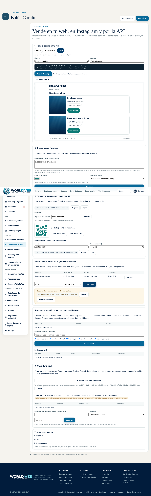
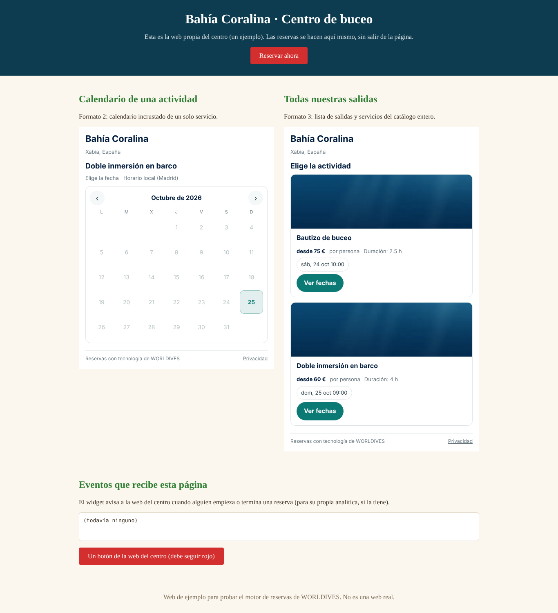
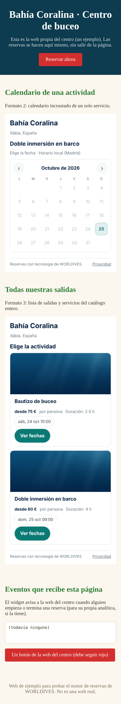
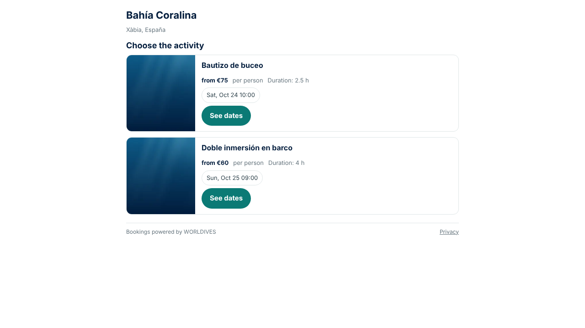
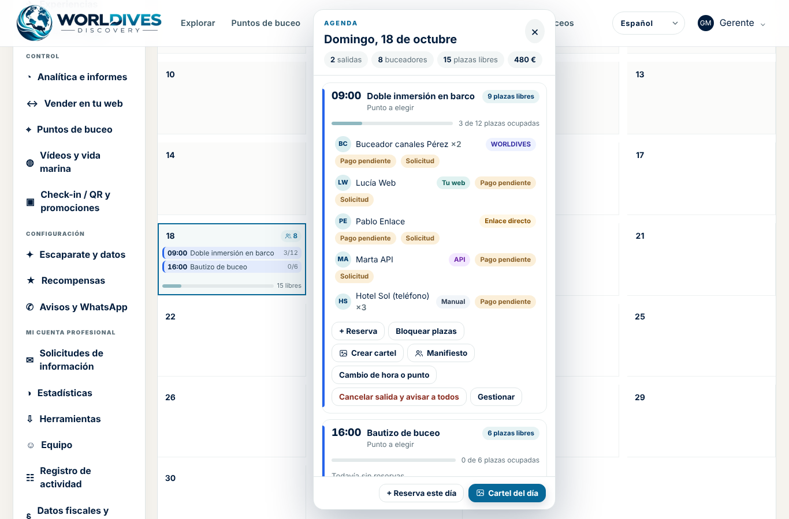
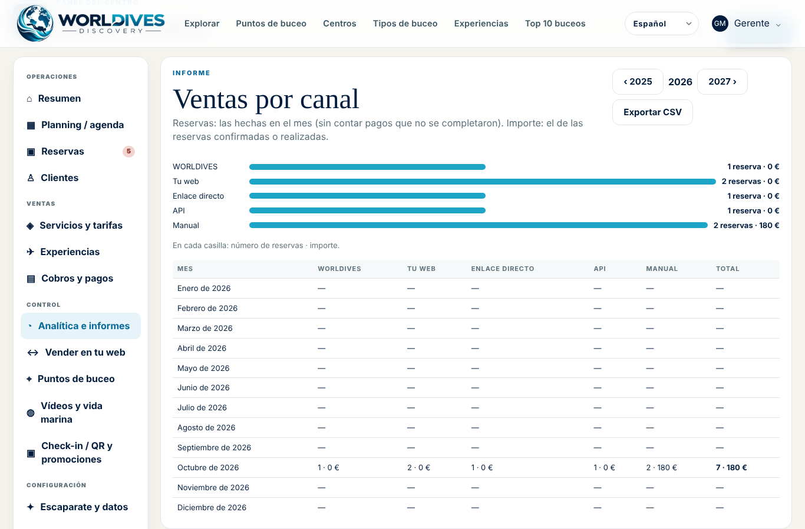

# Cómo poner WORLDIVES en tu web

Guía para centros de buceo y profesionales (v50.56). En 10 minutos tu web vende tus salidas con las **mismas plazas**
que WORLDIVES: lo que se reserva en tu web desaparece al momento de WORLDIVES, de tus enlaces y de la API, y al revés.
No necesitas programador.

Lo necesitas en el plan **«Motor de reservas»** o **«Pro»** (con la ficha gratuita tu web enseña «Solicitar
información»). Todo se hace en **Panel → Vender en tu web**.



## 1. Elige cómo se verá

| Formato | Qué ve tu cliente | Mejor para |
|---|---|---|
| **Botón** | Un botón «Reservar» que abre la reserva encima de tu página | La cabecera o cada ficha de actividad |
| **Calendario** | Las fechas libres de un servicio, dentro de tu página | La página de una actividad concreta |
| **Lista** | Tus salidas y servicios con sus próximas fechas | Una página «Reservas» o «Actividades» |

En **«Mostrar»** eliges todo el catálogo, un solo servicio («Solo «Bautizo de buceo»») o un tipo. Debajo tienes la
**vista previa en vivo**: así se verá en tu web.



## 2. Copia el código

Pulsa **«Copiar el código»**. Son dos líneas, por ejemplo:

```html
<script src="https://worlddivesdiscovery.com/widget.js" async></script>
<div data-worldives="calendario" data-centro="tu-centro"></div>
```

No toca los estilos de tu web ni pone cookies. Usa tu color, tu logo y el idioma del visitante (o el que fijes).

## 3. Autoriza tu dominio

En **«2 · Dónde puede funcionar»** escribe la dirección de tu web sin `https://`, una por línea: `tuweb.com` y, si
la usas, `www.tuweb.com`. Para todas las subdirecciones, `*.tuweb.com`. **El widget solo se carga en los dominios que
pongas**: si alguien copia tu código en otra web, no funciona.

## 4. Pégalo en tu web

Elige tu plataforma. Los pasos son los mismos que salen en el panel («7 · Guía paso a paso»).

### WordPress

1. Entra en el escritorio de WordPress y abre la página donde quieres vender.
2. Pulsa **«+»** y añade un bloque **«HTML personalizado»**.
3. Pega el código y pulsa **«Actualizar»**.
4. Autoriza tu dominio (paso 3), por ejemplo `tuweb.com`.
5. Abre la página: verás el botón, el calendario o la lista.

### Wix

1. En el editor de Wix pulsa **«Añadir elementos» → «Insertar código» → «Código integrado»** (o «HTML iframe»).
2. Pega el código en «Código» y pulsa **«Actualizar»**.
3. Ajusta el tamaño del recuadro (el calendario y la lista crecen solos dentro).
4. Autoriza tu dominio de Wix (por ejemplo `tunombre.wixsite.com`) y el tuyo propio si lo tienes.
5. **Publica** la web.

### Squarespace

1. Edita la página y pulsa **«Añadir bloque» → «Código»**.
2. Pega el código (modo HTML) y guarda.
3. Autoriza tu dominio (por ejemplo `tunombre.squarespace.com` y el tuyo).
4. **Publica** los cambios.

### Webflow o HTML propio

Pega las dos líneas donde quieras que salga (en Webflow, con un elemento **«Embed»**). Si la plataforma no deja pegar
HTML, usa el enlace o el QR del punto 5.

> **Capturas de WordPress, Wix y Squarespace:** no las incluimos porque hacen falta cuentas en esas plataformas, que no
> tenemos para las pruebas. Las capturas de esta guía son de la **web de ejemplo** de la demo
> (`http://localhost:8101`, README-PRUEBAS, apartado 14), que lleva el código pegado en sus tres formatos.



## 5. Sin tocar tu web: tu página, enlaces y QR

- **Tu página de reservas**: `https://worlddivesdiscovery.com/c/tu-centro`, con tu logo y tu color. Para Instagram,
  WhatsApp, Google o un cartel.
- **Enlace directo a un servicio o a una fecha**, para mandarlo por WhatsApp.
- **QR** de tu página, en SVG o PNG, para imprimir.



## 6. Qué pasa cuando alguien reserva en tu web

- El cliente elige fecha y hora (siempre en la hora local de tu centro), escribe sus datos y paga o envía la solicitud,
  según cómo tengas cada servicio («Pago al reservar» o «Bajo petición»).
- **Los pagos van a tu cuenta de Stripe**, igual que en WORLDIVES. Las devoluciones salen de la misma cuenta.
- Te llega **el aviso al momento** (correo y panel) y la reserva aparece en **Reservas** y en el **planning** con la
  etiqueta **«Tu web»**.
- El cliente recibe la confirmación con tu nombre y tu logo; si responde al correo, te escribe a ti.
- **El cliente es tuyo.** WORLDIVES trata sus datos solo para gestionar la reserva, por tu encargo: no le manda
  publicidad y ningún otro centro lo ve. Si él quiere, puede crearse una cuenta de WORLDIVES al final (es opcional).



## 7. Y además

- **Reservas por teléfono o en la tienda**: «+ Nueva reserva» en el panel, con la opción de mandar un enlace de pago.
- **Bloquear plazas** para un hotel o una agencia, sin cliente.
- **Ventas por canal**: reservas e importe de cada canal, mes a mes (Analítica e informes).
- **Seguro de buceo**: en cada servicio, «Exige seguro de buceo» (No · Se comprueba en el centro · Obligatorio para
  reservar online). Vale igual para tu web.
- **Tu propio sistema** (una web a medida, tu programa de gestión): la API, los avisos automáticos (webhooks) y los
  calendarios iCal. Instrucciones técnicas en `docs/api/` del paquete.



## Problemas frecuentes

| Lo que ves | Por qué | Qué hacer |
|---|---|---|
| No sale nada en tu web | El dominio no está autorizado o tiene `https://` | Paso 3: escribe solo `tuweb.com` (y `www.tuweb.com`) |
| Sale «Solicitar información» | Tu plan no incluye el widget, o no tienes servicios con fechas | Revisa tu plan y que tus servicios tengan salidas |
| «Pago al reservar · no disponible» | Los cobros online no están activos | Panel → Cobros y pagos, o pasa el servicio a «Bajo petición» |
| En Wix el calendario sale cortado | El recuadro es pequeño | Hazlo más alto en el editor |
| Un enlace antiguo dejó de funcionar | Cambiaste la dirección de tu página | Copia el enlace y el QR nuevos |
